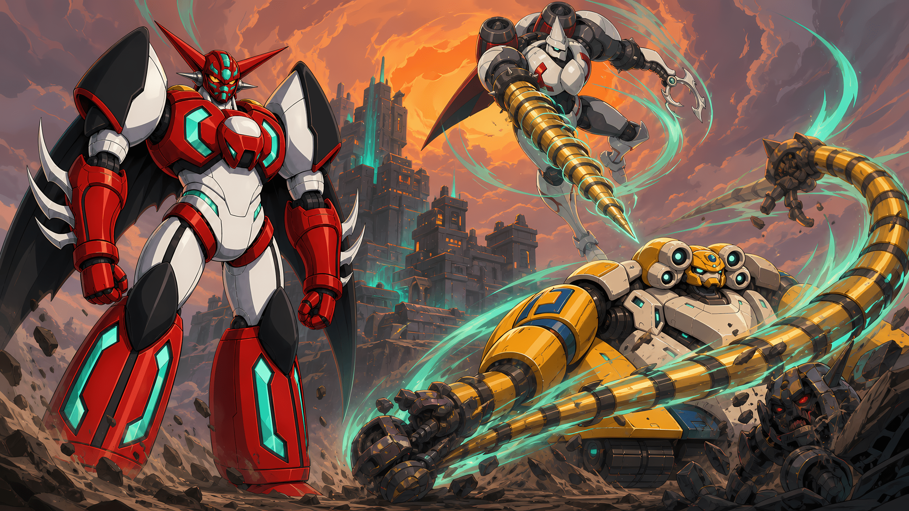

# Slay the Spire 2 - Shin Getter Mod

[简体中文](README.md) | [日本語](README_JP.md)



**Three hearts. One Getter. Endless evolution.**

Shin Getter crosses space and time to climb the Spire. Shift between Shin Getter 1's explosive offense, Shin Getter 2's high-speed tactics, and Shin Getter 3's iron defense; then awaken Shin Getter Dragon and let the Getter Rays consume the tower. This is a gameplay character mod built around transformations, deckbuilding, and presentation, not a simple reskin.

> Shin Getter Mod `v1.4.0` · Slay the Spire 2 stable `0.111.1` · Godot `4.5.1 Mono` · .NET `9` · 简体中文 / English / 日本語

[Stable download](https://github.com/AiurArtanis/sts2-shin-getter-mod/releases/latest) · [Previous releases](https://github.com/AiurArtanis/sts2-shin-getter-mod/releases/tag/mod-v1.3.0) · [GitHub Issues](https://github.com/AiurArtanis/sts2-shin-getter-mod/issues)

## Versions and downloads

- Game stable `0.111.1`: [stable ZIP](https://github.com/AiurArtanis/sts2-shin-getter-mod/releases/download/mod-v1.4.0/shin-getter-mod-v1.4.0.zip).
- Game `0.113 Beta` (tested on `0.113.1`): [113 Beta ZIP](https://github.com/AiurArtanis/sts2-shin-getter-mod/releases/download/mod-v1.4.0/shin-getter-mod-v1.4.0-beta.113.zip). Do not mix files from the two packages.
- Game stable `0.109`: [previous stable v1.3.0 package](https://github.com/AiurArtanis/sts2-shin-getter-mod/releases/download/mod-v1.3.0/shin-getter-mod-v1.3.0.zip).
- Game `0.111 Beta`: [previous v1.3.0 package for 111 Beta](https://github.com/AiurArtanis/sts2-shin-getter-mod/releases/download/mod-v1.3.0/shin-getter-mod-v1.3.0-beta.111.zip).
- When switching game versions, replace the DLL, PCK, JSON, and `mod_image.png` together, then restart the game. Do not mix files from different packages.
- Known external compatibility issue: old `BaseLib 3.3.7` fails its `CardPileCmd.Add` transpiler on 0.111 Beta and can freeze manual card play. Update BaseLib, or disable BaseLib and dependent mods in the Beta environment.

## ⚡ Combat at a glance

- **Four forms, one character.** Shin Getter 1 focuses on Vigor bursts; Shin Getter 2 gains extra Energy and draw while its Block is halved; Shin Getter 3 holds the line with Plating and defensive retaliation; Shin Getter Dragon accepts rewards from all three forms.
- **Transformation is a decision.** Form-specific cards highlight the strong actions available now. Movement, transformation cards, and related relics let you make shifting part of an attacking turn.
- **Built around Shin Getter from cards to presentation.** Custom card frames, character animation, VFX, voices, finishing music, and a dedicated character-select scene form one experience.
- **Integrated into the Spire instead of being a reskin.** Alongside the full card pool are exclusive relics, potions, enchantments, an event, and Ancient dialogue.

## 🧭 Starter routes

- **Vitality burst:** Build Vigor, then finish with cards such as *Valor* and *Dive Strike*.
- **Exhaust loop:** Use exhausting cards to trigger *Getter Claw*'s free damage. *Parts Swap* recovers key pieces, while Shin Getter 2 can further amplify the payoff.
- **Iron retaliation:** Stack Plating and Block in Shin Getter 3, then turn the enemy turn into a chance to counterattack.
- **Transformation chain:** Build around frequent shifting, movement-triggered transformations, and *Chosen One* so each change becomes resources or defense.

Ki supports several high-impact effects. Evolution and Radiation create additional late-game paths. Choose a primary engine first, then let the remaining mechanics support it.

## 📦 What's included

Version `v1.4.0` includes:

- **82 cards** (including event and generated cards) spanning four forms and several core mechanics
- **16 relics**, **7 potions**, and **2 enchantments**
- **Event Invasions**, **1 exclusive event**, and dedicated Ancient dialogue; the fourth wave adds 20 Shin Getter routes across 15 base-game events
- Simplified Chinese, English, and Japanese localization
- A complete character mod loaded through DLL, PCK, and JSON artifacts

## Ancient bonds

In a standard single-player Shin Getter run, complete the shared first meeting, then choose separate conversations with Ryoma, Hayato or Benkei. Their stories progress independently and relationships persist across runs. Reloading the same room restores the current conversation. Familiar themes unlock as bonds develop, with dedicated Neow and Architect dialogue and story callbacks.

These stories do not replace the original event's combat, rewards or scoring. The `sgd` console command inspects and constructs bond progress; changing progress is a debugging operation.

## v1.4.0

Targets game version 0.111.1 (stable).

### Gameplay

- Added the fourth wave of Event Invasions: 20 Shin Getter routes across 15 base-game events, with new event cards, relics, and a potion. Rewrote parts of existing invasion routes.
- Added a cheat command. Enter this phrase in the console: Now is not the time to worry about the laws of physics

### Bug Fixes

- Fixed a mixed-character multiplayer stall when challenging the three knights on Shin Getter's route in The Trial, and fixed combat-start synchronization on Shin Getter's route in Byrdonis Nest.
- Buying the Good Citizen Card still costs gold and no longer uses up that act's free purchase.
- Fixed some eligible Shin Getter skills that directly grant Block not gaining Nimble when acquired after Fresnel Lens.

### QoL / Balance

- Sped up Change Attack's transformation sequence. Spirit Commands now show the Ki icon and required amount alongside their existing card type.
- Added “Fragment of the Emperor” as a selectable BGM track. The merchant now greets Good Citizen Card holders based on whether that act's free purchase is still available and reacts differently when it is used.
- Chosen One grants less Block per transformation. Ki gain is unchanged.
- Reworked Spare Musashi Clone into Musashi's Hat.
- Saint Dragon Roar now has Eternal and deals more base damage. The copy obtained from Getter Mandala no longer comes with Corrupted.

## v1.3.0 2026-10-12

### Gameplay

- Added Ancient bonds: crossover interactions between the three-pilot team and the Ancients.

### Bug Fixes

- Fixed repeated Good Citizen Card free purchases on the same map.

### QoL / Balance

- Reworked Shining Spark and Star-Slashing Axe.
- Improved Expansion Strike and Tactical Retreat animations, and Shining Spark's hit timing.
- Optimized animation loading and reduced animation data and package size.
- Adjusted Drive, Shift Strike and Fighting Spirit card effects.
- Updated eight card illustrations and the compact card atlas, correcting texture references and sampling boundaries.

These additions target stable 109; updated 111 Beta compatibility is a separate delivery. The fourth event-invasion batch and the unconfirmed fighter-separation animation report are not part of this version.

## v1.2.2 release notes

- Added a master switch for mod battle BGM, execution themes, and previews; track choices are retained when disabled.
- Refreshed the 23-track BGM selection, adding Creation, Hostility, Forward, It's Time, and Bravery (Iron Saga Ver.).
- Default event combat music is now Onslaught, Hive elite music is Forward, and the execution theme is the OVA version of Bravery.
- Removed or invalid saved track choices now fall back to the default preset.

v1.2.2 provides separate stable-109 and 0.111-Beta packages. The Beta package also includes these BGM changes; use the matching asset and do not mix files.

[Download v1.2.2](https://github.com/AiurArtanis/sts2-shin-getter-mod/releases/tag/mod-v1.2.2) · `shin-getter-mod-v1.2.2.zip`

## v1.2.1 release notes

- Fixed multiplayer crashes.
- Fixed Shin Getter 1 disappearing after Triple Wood Carving transformations.
- Fixed character visuals in the Fake Merchant and Architect events.
- Fixed Hedgehog Tactic's form-condition highlighting.
- Corrected Saint Dragon Roar's description.
- Fixed status-icon display errors.

For 0.111 Beta, use the separate v1.2.1-beta.111 build. Do not mix stable and Beta packages.

[Download v1.2.1](https://github.com/AiurArtanis/sts2-shin-getter-mod/releases/tag/mod-v1.2.1) · `shin-getter-mod-v1.2.1.zip`

## 🆕 v1.2.0 release notes

[Download v1.2.0](https://github.com/AiurArtanis/sts2-shin-getter-mod/releases/tag/mod-v1.2.0) (`shin-getter-mod-v1.2.0.zip`)

- **Transformations and signature animation:** The three standard forms now have complete fighter separation and fusion sequences. Shin Getter Dragon gains three 30 fps signature actions, while Stoner Sunshine uses dedicated 90-frame animations for Shin Getter 1 and Dragon.
- **New combat content:** Added the Ancient card *Getter Landing*, Open Get and Shade presentation, plus Stoner Sunshine's in-combat special acquisition, preview, and finishing reward.
- **Expanded Event Invasions:** Eighteen base-game events gain Shin Getter routes, alongside four event cards, two event relics, and three event potions. These rewards stay out of normal random pools.
- **Music and voices:** Chunibyo Config can select, randomize, and preview Execution, normal, event, Elite, and Boss music. Combat responses, low-HP lines, and subtitle timing are also expanded.
- **Art and interface:** Updated twelve card portraits, added the animated rainbow `NEW` update badge, and corrected card-frame types, hover tips, and config interactions.
- **Balance and rules:** Reworked Final Getter Beam and refined Stoner Sunshine, Evolution Engine, Bold Plan, Getter Will, Spirit Commands, and related mechanics.
- **Stability fixes:** Fixed Radiation, Morale damage reduction, Spirit Command retention, Airborne Vulnerable duration, Maul animation, event rewards, multiplayer scope, and form-specific voices.

## 🃏 Full card gallery


## 🚀 Quick start

### Install the release

1. Download `shin-getter-mod-v1.2.2.zip` from the [v1.2.2 Release](https://github.com/AiurArtanis/sts2-shin-getter-mod/releases/tag/mod-v1.2.2), then extract `ShinGetterMod.pck`, `ShinGetterMod.dll`, `ShinGetterMod.json`, and `mod_image.png`.
2. Create a `ShinGetterMod` folder inside the game's mod-loading directory and place all four files together.
3. Launch the game, open **Settings → Mod Settings**, and enable “真盖塔模组” (Shin Getter Mod) under **Installed Mods**.
4. Accept the load prompt, fully quit, and relaunch the game. Start a new run and select **Shin Getter**.

### Install the 0.111 Beta build

1. Confirm that the game is on **Slay the Spire 2 0.111 Beta**.
2. Download `shin-getter-mod-v1.2.2.111-beta.zip` from the [v1.2.2 Release](https://github.com/AiurArtanis/sts2-shin-getter-mod/releases/tag/mod-v1.2.2).
3. Replace all four files in the same `ShinGetterMod` directory. Do not combine a stable-build DLL with a Beta PCK, or vice versa.
4. Fully quit and relaunch the game, enable the mod, and start a new run.

On a first run, follow the highlighted form-specific cards to establish a rhythm, then branch into one of the routes above.

### Steam Workshop

Once the Workshop edition is available, enable it as follows:

1. After subscribing, launch the game. From the main menu, open **Settings** and select **Mod Settings**.
2. Under **Installed Mods**, find “真盖塔模组” (Shin Getter Mod) and tick its enable box.
3. When the **Load Mods?** confirmation appears, choose **Load Mods** only after confirming the source is trusted. Fully quit and relaunch the game; enabling or disabling a mod takes effect only after a restart.
4. Start a new run and select **Shin Getter**.

`v1.0.0` is the first public release. Future game updates may affect compatibility; include the game version, mod version, reproduction steps, and relevant logs when reporting a problem.

## 🗺 Roadmap

- [ ] More events
- [ ] More elements inspired by *Super Robot Wars*
- [ ] Enemies from the *Getter Robo* universe
- [ ] A new *Destiny* deck archetype
- [ ] Improved animation presentation
- [ ] Dedicated card frames for Spirit Command cards
- [ ] Multiplayer support

## Build from source

### Requirements

- Build this branch against `sts2.dll` and `0Harmony.dll` from *Slay the Spire 2* stable `0.111.1`. Use the matching compatibility branch for Beta; do not mix assemblies.
- Godot `4.5.1 Mono`
- .NET SDK `9`
- A local game project directory that Godot can load for validation

The following dependencies come from a local game or development environment and are not tracked by this repository:

- `lib/sts2.dll`
- `lib/0Harmony.dll`
- Game- or editor-provided plugins under `addons/`, including FMOD, Spine, and Sentry

After restoring those dependencies, build the C# project:

```powershell
cd .\shin-getter-mod-godot
dotnet build .\ShinGetterMod.csproj -c Debug
```

The built DLL and PDB are copied to the ignored `build/` directory.

### Export a test package

Use the Godot `Windows Desktop` preset to export the PCK:

```powershell
godot --headless --quit --path . --export-pack "Windows Desktop" .\build\ShinGetterMod.pck
```

Place the following files together in the local game's mod directory:

- `ShinGetterMod.dll`
- `ShinGetterMod.pck`
- `ShinGetterMod.json`

For Godot resource changes, also run `tools/validate-mod-resources.gd` against a local game project and complete a headless load validation. Personal deployment scripts and machine-specific paths are intentionally not tracked.

## Repository layout

- `shin-getter-mod-godot/`: the complete Godot/C# mod project
- `shin-getter-mod-godot/src/`: cards, powers, relics, potions, enchantments, events, patches, and runtime code
- `shin-getter-mod-godot/scenes/`, `animations/`, `images/`, `materials/`, `shaders/`, `audio/`: Godot scenes and audiovisual assets
- `shin-getter-mod-godot/ShinGetterMod/`: mod data and Simplified Chinese, English, and Japanese localization
- `art/`: full card PNGs and the complete card-gallery mosaic
- `workshop/`: Steam Workshop copy and publishing materials

## Contributing and reporting issues

When reporting a problem, include the game version, mod version, reproduction steps, and relevant logs whenever possible. Keep code contributions focused and run at least the relevant C# build. Changes to Godot resources should also pass the full build, resource-validation, and load-validation pipeline.

Do not commit local game dependencies, `addons/`, `build/` artifacts, or personal test scripts.

Read the [contribution guide](CONTRIBUTING.md) before submitting code, and follow the [Code of Conduct](CODE_OF_CONDUCT.md) in project spaces. Report vulnerabilities privately under the [Security Policy](SECURITY.md), not through a public issue.

## License and asset notice

This is an unofficial fan-made mod. Names, characters, and source material related to *Slay the Spire 2* and Shin Getter remain the property of their respective rights holders.

The original code in this repository is released under the [MIT License](LICENSE). It does not grant permission to copy, adapt, or redistribute *Slay the Spire 2*, Shin Getter, or other third-party material; users remain responsible for confirming the rights and provenance of all related assets.
