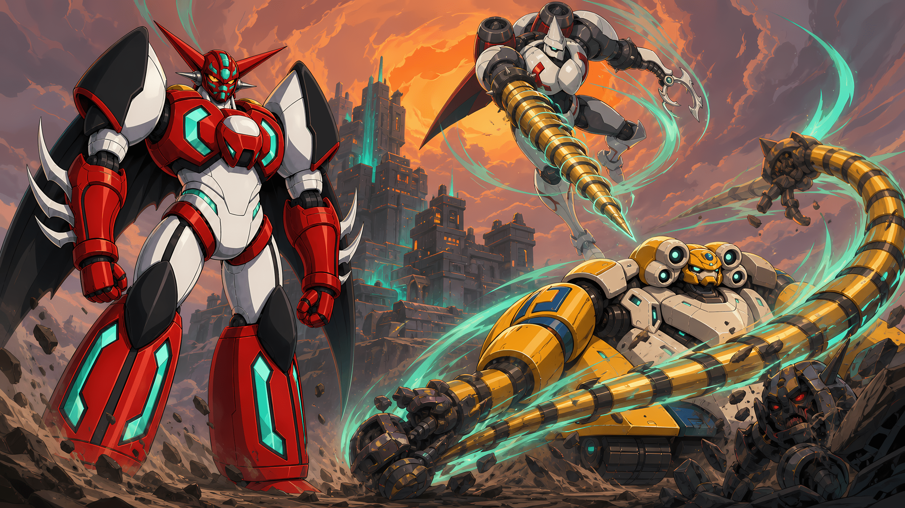

# Slay the Spire 2 - 真ゲッターMOD

[简体中文](README.md) | [English](README_EN.md)



**三つの心臓。一機のゲッター。無限の進化。**

時空を越えた真ゲッターが塔へ挑みます。ゲッター1の爆発力、ゲッター2の高速戦術、ゲッター3の鉄壁の防御を切り替え、最後には真ゲッタードラゴンを目覚めさせてゲッターレイで塔を飲み込みましょう。単なる見た目変更ではなく、変形、デッキ構築、演出が一体となったプレイアブルキャラクターMODです。

> 対応作業中のソース `v1.4.0-beta.113`（ゲーム `0.113.0`、未公開）· Godot `4.5.1 Mono` · .NET `9` · 简体中文 / English / 日本語

[v1.4.0 正式版のプレリリース](https://github.com/AiurArtanis/sts2-shin-getter-mod/releases/tag/mod-v1.4.0) · [113対応状況：issue#287](https://github.com/AiurArtanis/sts2-shin-getter-mod/issues/287) · [GitHub Issues](https://github.com/AiurArtanis/sts2-shin-getter-mod/issues)

## 🧪 Betaの保守対象

- **現在の保守対象は0.113 Betaです。** 本ブランチは対応・検証中で、113版パッケージは未公開です。進捗はissue#287を参照してください。ビルド成功だけでは実行時の互換性を保証しません。
- 2026-11-13以降、111-betaは履歴としてのみ保持し、新規開発・検証・公開を行いません。既存ブランチと証拠は削除しません。
- [v1.4.0 正式版のプレリリース](https://github.com/AiurArtanis/sts2-shin-getter-mod/releases/tag/mod-v1.4.0)にはゲーム正式版 `0.111.1` 用のみを収録し、113 Beta 版は含まれません。
- 過去の正式109版`shin-getter-mod-v1.3.0.zip`と111 Beta版`shin-getter-mod-v1.3.0-beta.111.zip`は[v1.3.0 Release](https://github.com/AiurArtanis/sts2-shin-getter-mod/releases/tag/mod-v1.3.0)にあります。113対応パッケージではありません。
- 正式版とBeta版の4ファイルを混在させないでください。ゲームブランチ切替後はDLL、PCK、JSON、`mod_image.png`をまとめて上書きし、ゲームを再起動してください。
- 既知の外部互換性問題：旧版 `BaseLib 3.3.7` は0.111 Betaで `CardPileCmd.Add` のtranspilerに失敗し、カード使用時に停止する場合があります。BaseLibを更新するか、Beta環境ではBaseLibとその依存Modを無効にしてください。

## ⚡ 戦闘の核

- **4形態で戦う1人のキャラクター。** ゲッター1は活力による爆発、ゲッター2はブロック半減と引き換えのエナジー・ドロー、ゲッター3は装甲と防殺反撃、真ゲッタードラゴンは3形態すべての報酬を扱います。
- **変形そのものが判断です。** 形態専用カードは今使える強力な行動を強調表示します。移動、変形カード、関連レリックで、変形を攻めのターンに組み込めます。
- **カードから演出まで真ゲッター仕様。** 専用カードフレーム、キャラクターアニメーション、VFX、ボイス、フィニッシュ曲、キャラクター選択画面をひとつの体験として収録しています。
- **外見変更ではなく、塔の世界へ統合。** 完全なカードプールに加え、専用レリック、ポーション、エンチャント、イベント、古の者との会話を用意しています。

## 🧭 初心者向けビルド

- **活力バースト：** 活力を貯めてから、「熱血」や「ダイブストライク」などで大きく決めます。
- **消滅ループ：** 消滅を持つカードで「ゲッタークロー」の無料ダメージを発動。「パーツ交換」で重要な部品を再利用し、ゲッター2で見返りをさらに伸ばします。
- **鉄壁の反撃：** ゲッター3で装甲とブロックを積み、敵ターンを反撃の機会へ変えます。
- **変形連鎖：** 頻繁な変形、移動での変形、「選ばれし者」を軸に、切り替えるたびにリソースや防御を得ます。

気力は複数の強力な効果を支え、進化と放射線は終盤の成長先を増やします。まず主力エンジンをひとつ選び、他のメカニクスにはそれを支えさせると安定します。

## 📦 収録内容

`v1.4.0-beta.113` の収録内容：

- 4形態と複数の主要メカニクスを扱う**カード82枚**（イベント・生成カードを含む）
- **レリック16個**、**ポーション7種**、**エンチャント2種**
- **イベント侵入**、**専用イベント1件**、専用の古の者との会話。第4弾では本編イベント15件に分岐20本を追加
- 簡体字中国語、英語、日本語のローカライズ
- DLL、PCK、JSONを組み合わせて読み込む完全なキャラクターMOD

## 古の者との絆

通常の真ゲッターのシングルプレイでは、共通の初対面会話を終えてから竜馬・隼人・弁慶それぞれの会話を選べます。物語は別々に進み、関係の進行はランを越えて保存されます。同じ部屋の再開時には会話を復元します。絆が深まると顔なじみのテーマが現れ、ネオーや建築家には専用会話と過去の物語への言及もあります。

元のイベントの戦闘・報酬・採点は置き換えません。`sgd`コンソールコマンドで絆の進行を確認・設定できますが、進行の変更はデバッグ操作です。

## v1.4.0-beta.113

ゲーム 0.113 Beta（最低 0.113.0）向け。正式版のファイルと混在させないでください。

### ゲームプレイ

- 第4弾のイベント侵入を追加。本編イベント15件に真ゲッター専用の分岐20本を加え、イベントカード、レリック、ポーションを追加しました。既存の侵入分岐のシナリオも一部改稿。
- チートコマンドを追加。コンソールに入力：物理法則もあったもんじゃねえな

### 不具合修正

- 異なるキャラクターで組んだマルチプレイで、「裁判」の真ゲッター分岐から三騎士戦に進めなくなる不具合を修正。「ビャードニスの巣」の真ゲッター分岐で戦闘を開始する際の同期も修正しました。
- 良き市民証の購入には引き続きゴールドが必要ですが、その購入で同じ章の無料購入枠を消費しなくなりました。
- フレネルレンズ入手後に新たに入手した、ブロックを直接得る一部の対象となる真ゲッターのスキルに「身軽」が付かない不具合を修正。

### QoL / バランス

- 「チェンジアタック」の連続変形演出を高速化。精神コマンドカードは、既存のカードタイプ欄に気力アイコンと必要量を表示します。
- 選択可能な BGM に「皇帝の欠片」を追加。良き市民証を持っていると、無料購入枠の使用状況に応じて商人の挨拶が変わり、無料購入の成立時にも専用の反応が出ます。
- 「選ばれし者」で変形時に得るブロックを減少。気力の獲得量は変更ありません。
- 「予備の武蔵クローン」を「武蔵の帽子」にリニューアル。
- 「聖龍咆哮」に「永劫」を追加し、基本ダメージを引き上げました。ゲッターマンダラで入手する「聖龍咆哮」には「蝕み」が付かなくなりました。

## v1.3.0 2026-10-12

### ゲームプレイ

- 古の者との絆システムを追加：三人チームと古の者のクロスオーバー。

### 不具合修正

- 良き市民証による同一マップでの無料購入の重複を修正。

### QoL / バランス

- シャインスパークと斬星斧を刷新。
- 膨張ストライクと戦術撤退のアニメーション、およびシャインスパークの命中タイミングを改善。
- アニメーションの読み込みを最適化し、アニメーションデータとパッケージを軽量化。
- 気迫、シフトストライク、闘志のカード効果を調整。
- カードイラスト8枚とコンパクトなカードアトラスを更新し、テクスチャの参照とサンプリング境界を修正。

正式109向けの内容です。111 Betaの更新対応は別途提供します。第4弾イベント侵入と未確認の戦闘機分離アニメーション報告は本バージョンに含みません。

## v1.2.2 更新内容

- 戦闘BGM・処刑曲・試聴をまとめて切り替えるMOD BGMスイッチを追加。オフにしても選曲は保持されます。
- 選択可能なBGMを23曲に更新し、「創造」「敵状」「前進」「今がその時だ」「勇壮（機動戰隊Ver.）」を追加。
- イベント戦の標準曲を「襲来」、巣窟のエリート戦を「前進」、処刑曲をOVA版「勇壮」に変更。
- 削除済み・無効な保存済みの選曲は標準設定に戻ります。

v1.2.2には正式109用と0.111 Beta用の別パッケージがあります。Beta版にも今回のBGM更新を収録しています。対応する配布物を使用し、ファイルを混在させないでください。

[v1.2.2をダウンロード](https://github.com/AiurArtanis/sts2-shin-getter-mod/releases/tag/mod-v1.2.2) · `shin-getter-mod-v1.2.2.zip`

## v1.2.1 更新内容

- マルチプレイのクラッシュを修正。
- 三位一体の木彫りによる変形後に真ゲッター1が消える問題を修正。
- 偽商人・建築家イベントのキャラクター表示を修正。
- ハリネズミ戦術の形態条件の強調表示を修正。
- 聖龍咆哮のカード説明を修正。
- 状態アイコンの表示不具合を修正。

0.111 Betaでは専用のv1.2.1-beta.111をご利用ください。正式版とBeta版のファイルを混在させないでください。

[v1.2.1をダウンロード](https://github.com/AiurArtanis/sts2-shin-getter-mod/releases/tag/mod-v1.2.1) · `shin-getter-mod-v1.2.1.zip`

## 🆕 v1.2.0 リリースノート

[v1.2.0をダウンロード](https://github.com/AiurArtanis/sts2-shin-getter-mod/releases/tag/mod-v1.2.0)（`shin-getter-mod-v1.2.0.zip`）

- **変形と専用アニメーション：**3つの通常形態に戦闘機の分離／合体演出を追加。真ゲッタードラゴンには30fpsの専用アクション3種を追加し、ストナーサンシャインはゲッター1とドラゴンで専用90フレーム演出を使用します。
- **新しい戦闘コンテンツ：**先古カード「ゲッター登場」、オープンゲットと分身の演出を追加し、ストナーサンシャインに戦闘中の特殊入手、専用プレビュー、フィニッシュ報酬を実装。
- **イベント侵入の拡充：**18個の原作イベントに真ゲッター分岐を追加し、イベントカード4枚、イベントレリック2個、イベントポーション3種を実装。通常のランダムプールには入りません。
- **音楽とボイス：**中二設定からフィニッシュ曲、通常／イベント／エリート／ボス戦BGMを選択・ランダム化・試聴可能に。戦闘応答、低HPボイス、字幕タイミングも拡充しました。
- **アートとUI：**カードイラスト12枚を更新し、虹色アニメーションの`NEW`表示を追加。カードフレーム種別、ホバーヒント、設定画面の操作も修正しました。
- **バランスとルール：**ファイナルゲッタービームを再設計し、ストナーサンシャイン、進化エンジン、大胆な計画、ゲッターの意志、精神コマンドなどを調整。
- **安定性修正：**放射能、気力によるダメージ軽減、精神コマンドの保留、飛翔の弱体、モールのアニメーション、イベント報酬、マルチプレイ範囲、形態別ボイスを修正。

## 🃏 全カードギャラリー


## 🚀 クイックスタート

### リリース版のインストール

1. [v1.2.2 Release](https://github.com/AiurArtanis/sts2-shin-getter-mod/releases/tag/mod-v1.2.2) から `shin-getter-mod-v1.2.2.zip` をダウンロードし、`ShinGetterMod.pck`、`ShinGetterMod.dll`、`ShinGetterMod.json`、`mod_image.png` を展開します。
2. ゲームのMOD読み込みディレクトリに `ShinGetterMod` フォルダーを作成し、4ファイルをまとめて配置します。
3. ゲームを起動し、**設定 → MOD設定**を開いて、**インストール済みのMOD**から「真盖塔模组」（真ゲッターMOD）を有効にします。
4. 読み込み確認を承認した後、ゲームを完全に終了して再起動します。新しいランで**真ゲッター**を選択してください。

### 過去の0.111 Beta版（保守終了・113では使用不可）

1. ゲームが **Slay the Spire 2 0.111 Beta** になっていることを確認します。
2. [v1.3.0 Release](https://github.com/AiurArtanis/sts2-shin-getter-mod/releases/tag/mod-v1.3.0) から過去の `shin-getter-mod-v1.3.0-beta.111.zip` をダウンロードします。
3. ZIP内の4ファイルを同じ `ShinGetterMod` ディレクトリへすべて上書きします。正式版のDLLとBeta版PCKなどを混在させないでください。
4. ゲームを完全に終了して再起動し、Modを有効化して新しいランを開始します。

最初のプレイでは、強調表示された形態専用カードを手掛かりにリズムを作り、慣れたら上記のビルドへ進むのがおすすめです。

### Steam Workshop

Workshop版の公開後は、次の手順でも有効化できます。

1. MODを購読した後、ゲームを起動します。メインメニューから**設定**を開き、**MOD設定**を選びます。
2. **インストール済みのMOD**で「真盖塔模组」（真ゲッターMOD）を探し、有効化のチェックを入れます。
3. **MODを読み込みますか？**と表示されたら、提供元が信頼できることを確認した上で**MODを読み込み**を選びます。ゲームを完全に終了して再起動してください。MODの有効化・無効化は再起動後に適用されます。
4. 新しいランを開始し、**真ゲッター**を選択します。

`v1.0.0` は最初の一般公開版です。今後のゲーム更新により互換性へ影響が出る場合があります。不具合報告にはゲームバージョン、MODバージョン、再現手順、関連ログを添えてください。

## 🗺 今後のロードマップ

- [ ] さらなるイベント
- [ ] 『スーパーロボット大戦』シリーズを意識した要素
- [ ] 『ゲッターロボ』世界の敵
- [ ] 新たな「宿命」型ビルド
- [ ] アニメーション表現の改善
- [ ] 精神コマンドカード専用のカード枠
- [ ] マルチプレイ対応

## ソースからのビルド

### 必要な環境

- 本対応ブランチは『Slay the Spire 2』`0.113.0` Beta向けの検証中ソースで、未公開です。過去の109版・111版を113対応パッケージとして使用しないでください。
- Godot `4.5.1 Mono`
- .NET SDK `9`
- Godotが検証用に読み込めるローカルのゲームプロジェクトディレクトリ

次の依存ファイルはローカルのゲーム環境または開発環境から取得するため、このリポジトリでは管理していません。

- `lib/sts2.dll`
- `lib/0Harmony.dll`
- FMOD、Spine、Sentryなど、ゲームまたはエディターが提供する `addons/` 配下のプラグイン

依存ファイルを用意した後、C#プロジェクトをビルドします。

```powershell
cd .\shin-getter-mod-godot
dotnet build .\ShinGetterMod.csproj -c Debug
```

ビルドされたDLLとPDBは、Git管理対象外の `build/` ディレクトリへコピーされます。

### テストパッケージのエクスポート

Godotの `Windows Desktop` プリセットでPCKをエクスポートします。

```powershell
godot --headless --quit --path . --export-pack "Windows Desktop" .\build\ShinGetterMod.pck
```

次のファイルをローカルゲームの同じModディレクトリへ配置します。

- `ShinGetterMod.dll`
- `ShinGetterMod.pck`
- `ShinGetterMod.json`

Godotリソースを変更した場合は、ローカルゲームプロジェクトから `tools/validate-mod-resources.gd` を実行し、ヘッドレス読み込み確認も行ってください。個人用の配置スクリプトや環境固有のパス設定はリポジトリで管理しません。

## リポジトリ構成

- `shin-getter-mod-godot/`：Godot/C# MODプロジェクト一式
- `shin-getter-mod-godot/src/`：カード、パワー、レリック、ポーション、エンチャント、イベント、パッチ、ランタイムコード
- `shin-getter-mod-godot/scenes/`、`animations/`、`images/`、`materials/`、`shaders/`、`audio/`：Godotのシーンと視聴覚リソース
- `shin-getter-mod-godot/ShinGetterMod/`：MODデータと簡体字中国語・英語・日本語のローカライズ
- `art/`：全カードPNGとカードギャラリーのモザイク画像
- `workshop/`：Steam Workshop向けの紹介文と公開用素材

## コントリビューションと不具合報告

不具合を報告する際は、可能な限りゲームバージョン、MODバージョン、再現手順、関連ログを添えてください。コードの変更範囲は明確に保ち、少なくとも関連するC#ビルドを実行してください。Godotリソースを変更した場合は、完全なビルド、リソース検証、読み込み検証も通す必要があります。

ローカルのゲーム依存ファイル、`addons/`、`build/` の成果物、個人用テストスクリプトはコミットしないでください。

コードを提出する前に [コントリビューションガイド](CONTRIBUTING.md) を読み、プロジェクト内では [行動規範](CODE_OF_CONDUCT.md) を守ってください。脆弱性は公開Issueではなく [セキュリティポリシー](SECURITY.md) に従って非公開で報告してください。

## ライセンスと素材について

本プロジェクトは非公式のファンメイドMODです。『Slay the Spire 2』および真ゲッターに関する名称、キャラクター、原作素材の権利は、それぞれの権利者に帰属します。

本リポジトリ内のオリジナルコードは [MITライセンス](LICENSE) で公開しています。このライセンスは『Slay the Spire 2』、真ゲッター、その他の第三者素材を複製、翻案、再配布する権利を付与するものではありません。関連素材の権利と出所は、利用者自身で確認してください。
